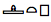
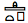
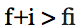
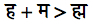
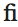
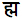
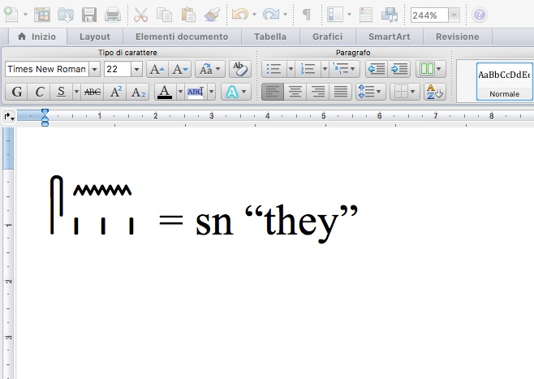
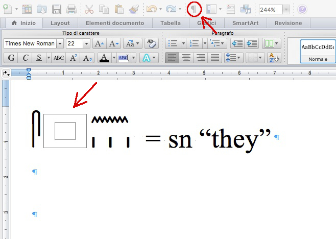
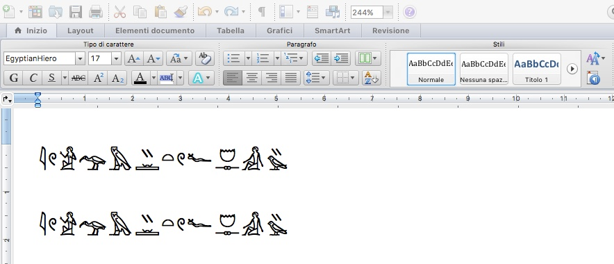
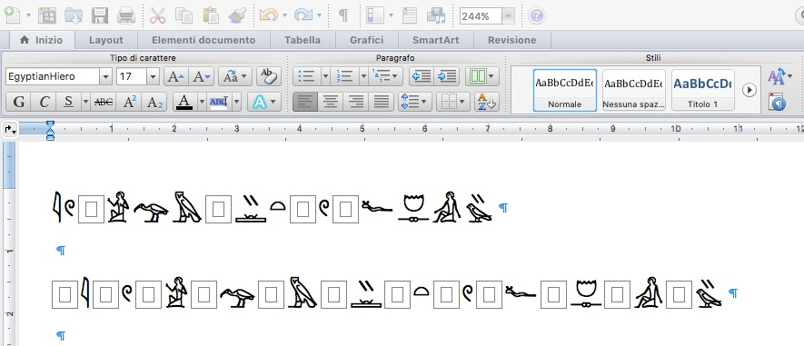

# Djehuty: user guide

Djehuty is an on-going project by Marwan Kilani (Freie Universität Berlin, Swiss National Science Foundation) aiming at the development of a Unicode font and an Input Method for ancient Egyptian hieroglyphs.

Djehuty is the Input Method. It lets you type hieroglyphs with an ordinary keyboard, using transliteration codes such as `kwi`. This guide covers the **macOS** version only, for now.

## Unicode hieroglyphs: what for?

Unicode hieroglyphs provide an easy and effective way to transcribe Egyptian hieroglyphs as strings of text, rather than as automatically generated images, as is the case with tools like JSesh. Dealing with hieroglyphs as text has a series of advantages. Unicode hieroglyphs can be used in any editor or text field and manipulated like any other text. They can be inserted, as text, within any text written with a text editor. They can be searched with standard search tools, in text editors or online search engines. They can be used and searched for in databases and tables, and they can be exported to standard PDF files and searched there.

Unicode hieroglyphs, however, can only be manipulated within the limits of the font used to display them. For this reason they are often not suited to paleographically accurate transcriptions of texts on actual objects. They are meant to transcribe texts in a uniform way, for instance when a text is quoted and discussed in a scientific paper because of its literary or linguistic content, rather than because of its appearance on the actual support.

Think about a medieval Latin manuscript. One can provide an accurate, form-wise palaeographical copy, in which all the graphic peculiarities of the scribe's letters are reproduced, or a content-wise accurate transcription in a standard modern Latin-script font, for instance in a critical edition. Unicode hieroglyphs are meant for the Egyptological equivalent of the latter.

## 1. Install

1. Download `Djehuty.pkg` from the project's Releases page.
2. Double-click the file and follow the installer. It asks for your administrator password. The installer also installs the hieroglyph font (EgyptianHiero, version 9.03) to `/Library/Fonts`, if it is not already installed in a newer version.
3. **Log out of your Mac and log back in.** macOS only shows new input methods after a login.

If macOS says the installer "cannot be opened because it is from an unidentified developer", open **System Settings > Privacy & Security**, scroll down to the message about Djehuty, and click **Open Anyway**.

## 2. Add Djehuty to your keyboards

1. Open **System Settings > Keyboard > Text Input > Edit** (on older macOS: **Input Sources**).
2. Click **+**, search for **Djehuty**, and add **Djehuty (Egyptian Hieroglyphs)**.
3. Select it from the input menu in the menu bar, or with your usual input-switching shortcut.

## 3. Deploy

Djehuty compiles its dictionary and settings when you choose **Deploy**. Until you do, the candidate window may use the wrong font or size.

**After every installation or update, choose Deploy once:**

1. Click the Djehuty icon in the menu bar.
2. Choose **Deploy**.
3. Wait for the notification that it has finished.

## 4. Type hieroglyphs

1. Type a transliteration code, for example `kwi`. The list of hieroglyphs appears.
2. Choose a hieroglyph by pressing its number (`1`, `2`, and so on), or with the arrow keys and Return.
3. To see more choices, press **`,`** (comma) to go to the next page. The **Page Up** key goes back.

### Symbols and numbers

Some keys also offer choices. The first choice is the plain character.

| Key | Choices |
| --- | --- |
| `[` | `[`, `⌜`, `⌞` |
| `]` | `]`, `⌝`, `⌟` |
| `<` | `<`, `⟨` |
| `>` | `>`, `⟩` |
| `(` `)` `{` `}` `\|` | the same character |
| `-` | `-` |
| `=` | `=`, `⸗` |
| `.` | `.` |
| `0`–`9` | the digit, its superscript (for example `¹`) and its subscript (for example `₁`), followed by the hieroglyphs for that code |

The symbols appear before the hieroglyphs in the list.

### Codes with hyphens and question marks

Some codes contain `-` or `?`, such as `pt-m-Aiw`. Type them exactly as they appear in the dictionary.

### Uppercase and lowercase

Uppercase and lowercase codes are different. `kA` and `ka` may give different hieroglyphs, so type the code exactly as shown in the dictionary.

### The list learns

Djehuty remembers the choices you make. The hieroglyphs you pick often for a code move up the list over time.

## 5. Quadrats and ligatures

### The problem

In actual texts, hieroglyphs are usually distributed into so-called "quadrats", virtual rectangles or squares that give a conceptual frame to organise the signs in space. For instance, the signs  are usually not written in a linear sequence, one after the other, but are reorganised within a single quadrat, in the form .

Most fonts display hieroglyphs only in linear sequences. The EgyptianHiero font reorganises the signs into quadrats.

### Ligatures for quadrats

To organise and display hieroglyphs in quadrats, the font uses a series of *ligatures* that are pre-encoded in the font itself.

Take the English ligature  or the Sanskrit ligature . Fonts that support ligatures turn the sequence f + i or ह + म into the ligatures  and .

EgyptianHiero uses the same mechanism: whenever it encounters a sequence of signs that matches one of its pre-encoded ligatures, it arranges those signs into the corresponding quadrat. So the sequence  is displayed as the quadrat .

This has several consequences:

1. **No positional markers are needed.** Unlike Manuel de Codage or JSesh, there is no need for characters such as `:`, `*` or `-` to indicate the relative position of the signs. Type the hieroglyphs one after the other, and the font groups them into quadrats.
2. **Search still works.** Because no special character is used, a quadrat still corresponds to its underlying sequence of signs. Search functions in text editors and online search engines can find signs inside quadrats, and even sequences of signs that span several quadrats.
3. **Only known quadrats can be shown.** The font can display only the quadrats that are pre-encoded in it. You cannot create a custom quadrat with EgyptianHiero. The font (version 9.03) contains about 10,600 quadrat ligatures, and new ones are added with each release. Most quadrats attested in the TLA are encoded, as well as many from Late Egyptian texts, so most texts can be transcribed without problems. New quadrats are added as they come up in the texts I am working on. Users are encouraged to send me any quadrat they would like to have, and I will add it in the next release.

Remember the purpose of texts encoded with Unicode fonts, described in the section "Unicode hieroglyphs: what for?" above.

## 6. Breaking ligatures

Quadrats are generated automatically whenever the font meets a relevant sequence of characters. Sometimes, however, two signs should **not** form a ligature. Conflicts can also occur, because the font applies ligatures in the direction of writing. If both the signs A-B and the signs B-C form a ligature, a sequence A-B-C will always display the ligature A-B, never B-C.

### The Breaking Ligature Character

This is solved with a **Breaking Ligature Character** (BLC): an invisible character that stops the font from joining two signs into a quadrat.

Two invisible characters can serve this purpose:

- **Zero-width space** (ZWSP, Unicode U+200B). This is the character the font author used in earlier versions of this text, and it is easy to manipulate in text editors such as LibreOffice.
- **Zero-width non-joiner** (ZWNJ, Unicode U+200C), which is what **Djehuty uses** in its dictionary since version 0.1.27. Whenever you type a Djehuty entry that contains a breaking character, the text you get contains ZWNJ.

Both are invisible in the final output. Comments on this choice are welcome.

### Search with breaking characters

Browsers and online search engines handle breaking characters differently. Some ignore them, so a sequence of hieroglyphs can be found even when it is spread across quadrats separated by a breaking character. Many text editors have search functions that ignore white space, and these can be used to ignore breaking characters too. These features change between software versions, so their exact behaviour needs testing.

### Seeing the breaking characters

Breaking characters are invisible in the output, but many text editors can display them together with other formatting marks when the "Formatting Marks" option is on.

Without the Formatting Marks option:



With the Formatting Marks option:



### When to use breaking characters

Breaking characters can be used in two ways:

1. **Only where needed:** use them only to prevent specific wrong ligatures.
2. **Between every quadrat:** use them between every quadrat, and in general to separate every sign that is not supposed to form a ligature.

Both examples below look exactly the same on screen:



Their underlying structure differs, one following the first approach and the other the second:



Both approaches are valid, depending on the context:

- **Static texts** that will not change (for example, texts for articles and monographs): the first approach is usually more practical.
- **Texts that will be used and edited later** (for example, databases and text corpora): the second approach is more appropriate. By separating every sign that should not be joined, the rendering of the text is not affected by new ligatures added in future versions of the font.

## 7. The font

The Djehuty package installs **EgyptianHiero 9.03** (font name `EgyptianHiero`) to `/Library/Fonts`. The project page offers version 4.03 as a separate download, and the legacy versions 3.03a (TTF, WOFF, WOFF2), which contain fewer ligatures, for basic tasks.

- Designed by Marwan Kilani, 2017–2026.
- Glyph outlines based on Mark-Jan Nederhof's font NewGardiner.
- All Rights Reserved.

### How to cite

Kilani Marwan, Djehuty, Font EgyptianHiero, https://github.com/MKilani/Djehuty

### Examples of use

The font EgyptianHiero is used in the following project:

- Daniel A. Werning, *Digitale Einführung in die hieroglyphisch-ägyptische Schrift und Sprache*, Humboldt-Universität zu Berlin, 2018–. https://wikis.hu-berlin.de/ancientegyptian/Inhaltsverzeichnis

## Menu bar options

Click the Djehuty icon in the menu bar to see:

- **Deploy**: recompile the dictionary and settings.
- **Logs**: open the log folder, for reporting a problem.
- **Settings**: open the settings file in your Djehuty folder.

## Troubleshooting

- **Djehuty does not appear in the input list:** log out and log back in.
- **The list does not show hieroglyphs:** choose **Deploy** from the menu bar, then try again.
- **The list is too small or shows the wrong font:** choose **Deploy**. This is needed after every installation or update.
- **Something else is wrong:** open **Logs** from the menu and include the newest log file when you report the problem.

## Where things are stored

| Location | Contents |
| --- | --- |
| `/Library/Input Methods/Djehuty.app` | the program |
| `/Library/Fonts/EgyptianHiero9_03.ttf` | the hieroglyph font |
| `~/Library/Djehuty` | your settings and the learned choices |

Djehuty uses its own folder, so it does not change the settings of other input methods, such as Squirrel.

## Uninstall

```sh
sudo rm -rf "/Library/Input Methods/Djehuty.app"
sudo rm -f /Library/Fonts/EgyptianHiero9_03.ttf
rm -rf ~/Library/Djehuty
```

Then log out and log back in.
